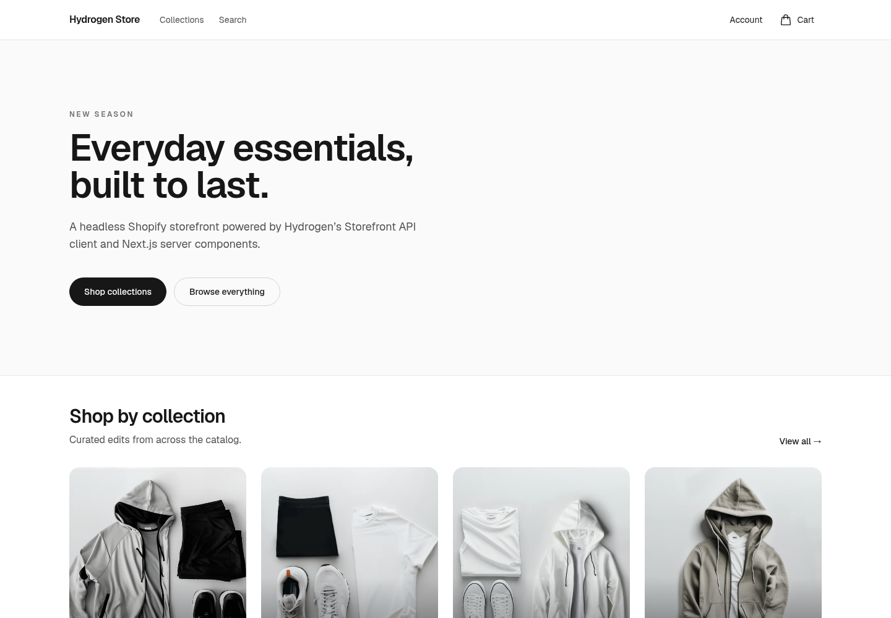
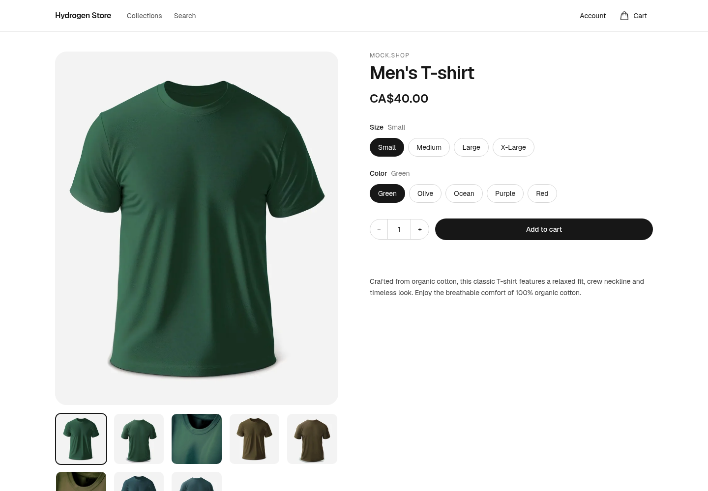
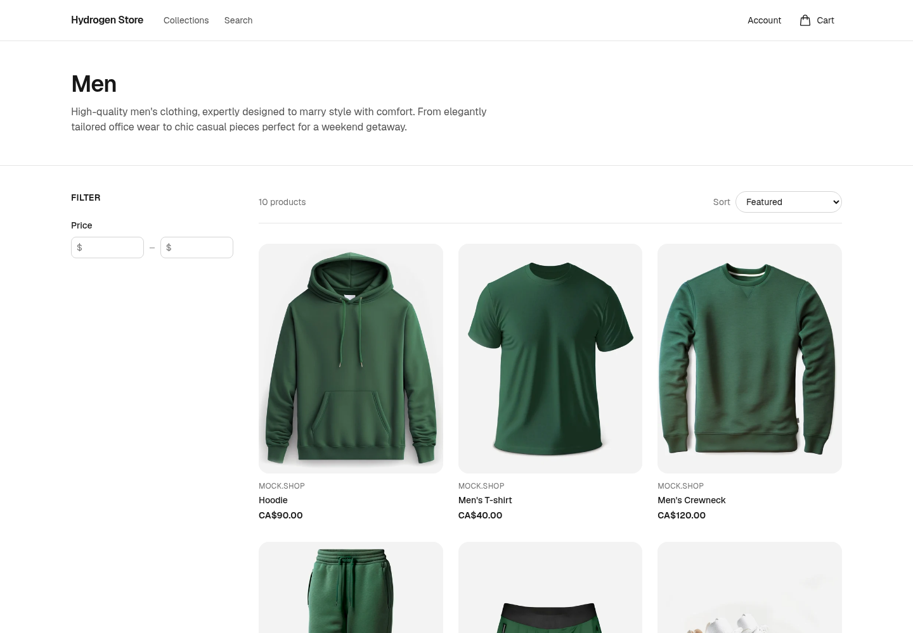
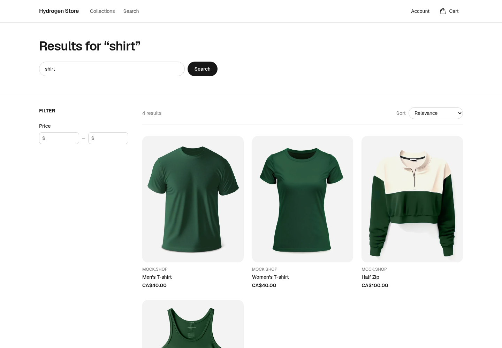

# Hydrogen Store — Headless Shopify Storefront

A production-shaped headless Shopify storefront built with **Next.js 16 (App
Router)**, **React 19** and **`@shopify/hydrogen` 2026.10**.

Full catalog browsing, variant selection, a server-rendered cart and a real
Shopify checkout handoff — all server-driven, fully typed, and working with
JavaScript disabled.

> **About the data:** this storefront runs against
> [`mock.shop`](https://mock.shop), Shopify's public tokenless demo catalog.
> It is **not** connected to a real merchant store, and no real orders can be
> placed. Every integration point is production code — pointing it at a live
> `*.myshopify.com` store is a configuration change, not a rewrite. See
> [Moving to a real store](#moving-to-a-real-store).

## Live demo

**🔗 Live demo:** _not yet deployed — add the URL here once hosted._

To run it locally in under a minute, see [Getting started](#getting-started).

## Screenshots

| Home | Product detail |
| --- | --- |
|  |  |

| Collection | Search |
| --- | --- |
|  |  |

_Captured from the running build against the `mock.shop` catalog._

## What's implemented

| Area | Status |
| --- | --- |
| Home page — featured collections + best sellers | ✅ Server-rendered, cached |
| Collection listing and collection detail | ✅ With sort, filters, cursor pagination |
| Product detail — gallery, variants, pricing | ✅ Variant state in the URL |
| Full-text product search | ✅ |
| Cart — add, update quantity, remove | ✅ Optimistic UI + server source of truth |
| Cart drawer + full `/cart` page | ✅ Accessible `<dialog>`, light dismiss |
| Discount codes and order notes | ✅ |
| Checkout handoff | ✅ Redirects to Shopify-hosted checkout |
| Customer accounts (login, profile, logout) | ⚙️ Code complete; needs a real store (see [Known limitations](#known-limitations)) |
| Shopify analytics + consent | ⚙️ Code complete; needs `SHOP_ID` |
| SEO — metadata, `robots.txt`, Shopify URL redirects | ✅ |
| Works without JavaScript | ✅ End to end |

### Verified behaviour

The following were exercised against the running production build:

- Product, collection, search and home queries return live `mock.shop` data.
- Variant selection round-trips through URL option params (`?Size=…&Color=…`).
- Cart create → add line → update quantity → remove line, all via Hydrogen's
  `/api/cart` handler, with the cart cookie persisting across requests.
- `/cart` server-renders the shopper's real cart, including the subtotal and a
  checkout link resolved from `cart.checkoutUrl`.
- `/checkout` redirects to the Shopify-hosted checkout.
- Discount codes round-trip to the Storefront API.
- `npm run build`, `npm run typecheck` and `npm run lint` all pass clean.

## Engineering highlights

- **Hydrogen 2026.10 as a library, not a framework.** Next owns routing;
  Hydrogen owns the Shopify endpoints, the cart/product/collection client
  stores, and the Storefront API client. One `createCartServerHandlers`
  instance serves the HTTP endpoint, seeds the server render, and types the
  React bindings — the three can't drift apart.
- **Cache Components.** The root layout is a static shell; every request-time
  read (cart, session) sits under `<Suspense>` with `connection()`. Catalog
  reads are explicit `"use cache"` cache-points with `cacheLife`/`cacheTag` —
  no route-segment `revalidate` guesswork.
- **Progressive enhancement throughout.** Variant pickers are real links, cart
  mutations are real form posts, filters are a `GET` form. Hydration upgrades
  them; it isn't required by them.
- **Typed GraphQL.** `npm run typecheck` runs `hydrogen gql check`, validating
  every `gql()` document against the live Storefront and Customer Account
  schemas — something `tsc` alone cannot do.
- **No secrets in the repo.** All configuration is environment-driven;
  `.env.example` is annotated and contains no credentials.

## Getting started

```bash
cp .env.example .env.local   # already points at mock.shop
npm run dev
```

Open http://localhost:3000.

### Scripts

| Script | What it does |
| --- | --- |
| `npm run dev` | `hydrogen skills check --mode=warn` then `next dev`. The check warns when a `@shopify/hydrogen` bump leaves the packaged skills stale. |
| `npm run build` | Production build. |
| `npm start` | Serve the production build. |
| `npm run typecheck` | `tsc --noEmit` **and** `hydrogen gql check`. The second half validates every `gql()` document against the Storefront and Customer Account schemas — `tsc` alone does not. |
| `npm run lint` | ESLint. |

## Configuration

All configuration is environment-driven; nothing is hardcoded. See
`.env.example` for the full annotated list.

| Variable | Purpose |
| --- | --- |
| `NEXT_PUBLIC_STORE_DOMAIN` | Shopify store domain. Defaults to `mock.shop`. |
| `NEXT_PUBLIC_STOREFRONT_API_TOKEN` | Public Storefront API token. **Commented out** for mock.shop, which only supports tokenless access. |
| `PRIVATE_STOREFRONT_API_TOKEN` | Private token, for upgrading SSR to a buyer-context client. Server-only. |
| `NEXT_PUBLIC_STOREFRONT_ID` | Analytics storefront ID (`"0"` when unprovisioned). |
| `SHOP_ID` | Numeric shop ID. Required by `ShopifyScripts` and the Customer Account API. |
| `PUBLIC_CUSTOMER_ACCOUNT_API_CLIENT_ID` | Customer Account OAuth client ID. |
| `CUSTOMER_ACCOUNT_SESSION_SECRET` | Encrypts the customer session cookie. |

Leave `NEXT_PUBLIC_STOREFRONT_API_TOKEN` commented out rather than set to an
empty string: env loaders parse `FOO=` as `""`, and the Storefront client
rejects an empty token.

### Moving to a real store

1. Set `NEXT_PUBLIC_STORE_DOMAIN` to `your-store.myshopify.com`.
2. Uncomment `NEXT_PUBLIC_STOREFRONT_API_TOKEN` and fill it in. A token is
   required for product tags, metafields, metaobjects, menus, and customers.
3. Set `SHOP_ID` so `ShopifyScripts` loads (analytics, consent banner, Standard
   Actions, Shop Pay) instead of only the Standard Actions module.
4. For customer accounts, add the Customer Account variables and register this
   origin's `/account/authorize` callback. OAuth needs public HTTPS — see the
   `hydrogen-local-https` skill.

## Architecture

```
proxy.ts                     handleShopifyRoutes before routing; forwards x-storefront-url
app/not-found.tsx            handleShopifyRedirects after a 404
app/robots.txt/route.ts      crawler policy
lib/i18n.ts                  defineShopifyI18n (single locale; add `routing` for markets)
lib/route-templates.ts       defineShopifyRouteTemplates (empty: all default paths)
lib/storefront.ts            per-request public client (reads headers())
lib/storefront-static.ts     module-scope client for cached catalog reads
lib/cart-handlers.ts         the one createCartServerHandlers instance
lib/cart.ts                  React cart bindings typed from those handlers
lib/customer-session.ts      customer session + encrypted-cookie session manager
```

**Hydrogen-owned endpoints** (registered via `handleShopifyRoutes`, not page
routes): `/api/cart`, `/api/{version}/graphql.json`, `/__shopify/*`,
`/checkout`, `/cart/{variantId}:{quantity}`, `/cart.js`, `/graphiql` (dev),
`/admin`, and `/account/{login,authorize,refresh,logout}`.

### Progressive enhancement

The storefront works without JavaScript:

- `/cart` server-renders the real cart; its line forms `POST` to `/api/cart`,
  which answers a form submit with a `303` back to the referring page.
- The header cart trigger is an `<a href="/cart">`; hydration upgrades the
  click to open the drawer.
- Variant option values are real `<a>` links carrying option params.
- Collection filters and sort are a `GET` form with an explicit `action`, plus
  a `<noscript>` submit button. Pagination is plain cursor links.

### Caching

`cacheComponents` is on, so the root layout is a static shell and every
request-time read (cart, session) sits under `<Suspense>` with `connection()`.
Catalog reads are explicit `"use cache"` cache-points with `cacheLife` /
`cacheTag` — there is no route-segment `revalidate`.

## Known limitations

- **mock.shop advertises no product filters** (`filters: []`) and ignores price
  filter arguments server-side. The filter UI, URL round-tripping, and chips are
  fully wired and work against a real store; against mock.shop only the price
  control renders (as a fallback) and the result set does not narrow.
- **Analytics needs `SHOP_ID`.** `ShopifyScripts` — and therefore the analytics
  bus, consent banner, and Shop Pay — only loads when `SHOP_ID` is set. Without
  it the storefront loads just Shopify's Standard Actions module so the cart
  still works, the view trackers no-op safely, and the cart tracker is not
  mounted (it throws rather than no-ops when the bus is absent). Set `SHOP_ID`
  to turn analytics on.
- **mock.shop has no Customer Account API.** Without `SHOP_ID` and a client ID
  the account handlers are not registered and `/account` shows a "not
  configured" panel. Sign-in was verified only as far as the OAuth HTTPS-origin
  check; completing a real login needs a public HTTPS origin with a registered
  callback.
- **404s return HTTP 200 in production builds.** Under Cache Components Next
  sends the prerendered shell first, which fixes the status, so `notFound()`
  streams the 404 UI with `<meta name="robots" content="noindex">` rather than a
  404 status. `next dev` returns a real 404. A true 404 status would mean
  checking handles in `proxy.ts`, adding a Storefront API request to every
  route.
- **`@shopify/hydrogen@2026.10.3` dev-only packaging issue.** Its export map
  gives `"."` a `development` condition but `"./customer-account"` none, so a
  bundler applying that condition can load two copies of a shared internal
  module and break the branded cart ↔ customer-account handoff. `proxy.ts`
  catches this and degrades to account handlers without cart buyer-identity
  sync, with a warning. Production builds are unaffected. Do **not** "fix" it
  with `serverExternalPackages` — that makes Next treat Hydrogen's client
  components as server components and breaks `ShopifyScripts`.
